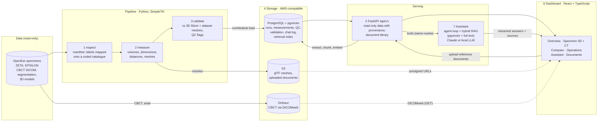
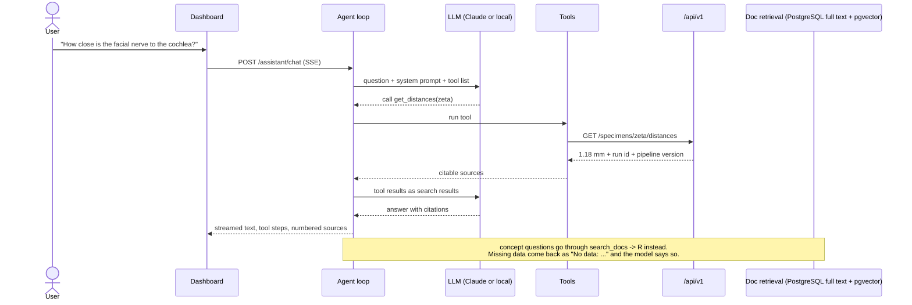

# CochleaHub

Research web platform that turns temporal-bone CT and segmentations into anatomical
measurements, 3D models and cited natural-language answers, for cochlear implant research.

Built on the public [OpenEar](https://doi.org/10.1038/sdata.2018.297) dataset (Sieber et al.,
2019), with specimens **ZETA** and **EPSILON** (cadaveric temporal bones). The architecture
follows the published Nautilus platform (Margeta et al., 2022). Every design decision is traced
to a paper in [`docs/DECISIONS.md`](docs/DECISIONS.md), and where no paper exists the entry says
so.

> **Not a clinical tool.** No medical recommendations. Data come from two cadaveric specimens and
> do not represent population statistics.

## Architecture



Stage 8 adds the evaluation, a Grafana comparison prototype and the AWS deployment (see below).
Each stage has its own page with a diagram, inputs and outputs, decisions and measured results:

| Stage | What it does | Page |
|---|---|---|
| 1 Data | find each specimen's files, read headers only, map labels onto a coded structure catalogue, write a manifest | [01-data](docs/architecture/01-data.md) |
| 2 Measurement | per-structure volume, area, dimensions; cochlear A/B/H; critical distances; web meshes | [02-measurement](docs/architecture/02-measurement.md) |
| 3 Validation & QC | compare with 3D Slicer and the dataset's meshes; automatic QC flags | [03-validation](docs/architecture/03-validation.md) |
| 4 Storage | PostgreSQL (+ pgvector), S3 and Orthanc DICOMweb, mirroring AWS | [04-storage](docs/architecture/04-storage.md) |
| 5 API | read-only versioned API with provenance and explicit missing data; document library | [05-api](docs/architecture/05-api.md) |
| 6 Dashboard | React dashboard with 3D anatomy, CT viewer, comparison across specimens, assistant and documents | [06-dashboard](docs/architecture/06-dashboard.md) |
| 7 Assistant | LLM agent over the API + hybrid RAG in PostgreSQL, cited, refuses medical advice | [07-assistant](docs/architecture/07-assistant.md) |
| 8 Evaluation & deploy | assistant and retrieval evaluation, tool comparison, AWS | [08-evaluation-deploy](docs/architecture/08-evaluation-deploy.md) |

### How a question to the assistant is answered



### Where it runs

| | Local development | AWS demo (cost-saving, stage 8) | Production target |
|---|---|---|---|
| Frontend | Vite dev server | S3 + CloudFront | S3 + CloudFront |
| API | uvicorn | Docker on one EC2 instance | ECS/Fargate |
| Database | PostgreSQL + pgvector in Docker | PostgreSQL + pgvector in Docker on EC2 | Amazon RDS for PostgreSQL (pgvector) |
| Meshes, documents | SeaweedFS (S3 API) | Amazon S3, presigned URLs | Amazon S3 |
| Document processing | in the API process | in the API process | queue worker (e.g. SQS) |
| CBCT archive | Orthanc in Docker | Orthanc on EC2, DICOMweb GET only | Orthanc in a private subnet, or AWS HealthImaging |
| LLM | Claude API or Ollama | Claude API (key in SSM) | Claude on Bedrock (EU region) or on-premises model |
| Access | localhost | CloudFront basic auth; EC2 reachable from CloudFront only | SSO |

## Results so far

- **Measurements:**

  | | ZETA | EPSILON |
  |---|---|---|
  | Scala tympani volume (published 23–50 mm³) | 34.65 mm³ | 33.78 mm³ |
  | Cochlea A / B / height | 8.97 / 6.81 / 4.36 mm | 8.97 / 7.26 / 4.46 mm |
  | Facial nerve → scala tympani | 1.18 mm | 0.14 mm |
  | Ear side | right | unknown (not stated by the dataset) |

  Validation ([ZETA](docs/validation/zeta.md), [EPSILON](docs/validation/epsilon.md)): volumes
  identical to 3D Slicer; full-resolution meshes within a mean 0.03–0.10 mm of the dataset's own
  meshes; QC passes with 5 warnings each.
- **Retrieval** (30 labelled questions, PostgreSQL hybrid): right passage in the top 5 for 97 %,
  first for 70 %. [D24, D26](docs/DECISIONS.md).
- **Assistant** (25 cases: answer, abstain when data are missing, refuse medical advice), Claude
  Sonnet: 25/25 correct behaviour, 0 numbers not grounded in a source, 13/15 citations pointing
  at the right source, median 5 s, $0.023 per question. Local qwen3.5:4b on a 4 GB GPU: 23/25,
  one answer with invented numbers, 11/15 citations, median 93 s.
  [Stage 8](docs/architecture/08-evaluation-deploy.md).
- **Dashboard tools**: React for the clinical surface, Grafana for operations, Power BI for
  aggregate reporting only. [Comparison](docs/evaluation/dashboard-tools.md).

## Repository layout

| Path | Content |
|---|---|
| `backend/src/cochleahub/pipeline` | dataset loading, structure catalogue, measurement, meshes, validation, QC (stages 1–3) |
| `backend/src/cochleahub/storage`, `db` | S3, DICOM Part 10 + Orthanc, SQLAlchemy models (stage 4) |
| `backend/src/cochleahub/api` | FastAPI app (stage 5) |
| `backend/src/cochleahub/assistant` | agent loop, tools, retrieval index in PostgreSQL, LLM backends (stage 7) |
| `backend/src/cochleahub/documents` | text and table extraction for uploaded documents (D25) |
| `backend/src/cochleahub/evaluation` | assistant evaluation runner and graders (stage 8) |
| `backend/tests` | pytest (84 tests; the PostgreSQL ones are skipped when no database is reachable) |
| `frontend/` | Vite + React + TypeScript dashboard (stage 6) |
| `infra/` | local Docker stack; optional Ollama and Grafana profiles |
| `deploy/aws/` | Terraform, server config and deploy script (stage 8) |
| `docs/` | decisions, references, architecture, validation, knowledge base for the assistant |
| `evaluation/` | evaluation cases and results |
| `Dataset/`, `data/` | dataset, one folder per specimen, and generated outputs (git-ignored) |

## Setup

Requirements: Python ≥ 3.11, Node ≥ 20, Docker.

```bash
cp .env.example .env                       # DATASET_ROOT holds one folder per specimen (Dataset/ZETA, ...)

# backend
cd backend
python -m venv .venv
.venv/Scripts/activate                     # Windows; use .venv/bin/activate on Linux/macOS
pip install -e ".[dev]"
cochleahub inspect                         # stage 1: verifies the dataset, writes the manifest
cochleahub measure                         # stage 2: metrics, meshes, distances
cochleahub validate                        # stage 3: Slicer + dataset-mesh comparison, QC report (SLICER_EXE optional)
pytest
# every command takes --specimen <id> (default zeta), e.g. cochleahub measure --specimen epsilon

# infra (Postgres :5432, Orthanc :8042, S3 API :8333)
docker compose -f infra/docker-compose.yml --env-file .env up -d
cd backend
alembic upgrade head                       # create / migrate the schema
cochleahub load                            # stage 4: run + QC -> PostgreSQL, meshes -> S3
cochleahub upload-dicom                    # stage 4: CBCT -> DICOM Part 10 -> Orthanc
uvicorn cochleahub.api.main:app --reload   # stage 5: http://localhost:8000/docs
cochleahub openapi                         # API schema -> docs/api/openapi.json
cochleahub index-docs                      # stage 7: docs -> PostgreSQL retrieval index (local embeddings, idempotent)
cochleahub eval-retrieval --store postgres # stage 8: retrieval evaluation (30 labelled questions)
cochleahub eval-assistant --backend claude # stage 8: 25-case assistant evaluation

# assistant backends: set ANTHROPIC_API_KEY for Claude, and/or run a local model with
# Ollama Desktop (set OLLAMA_MODELS to choose the model folder) ...
ollama pull qwen3.5:4b
# ... or in Docker: docker compose -f infra/docker-compose.yml --env-file .env --profile local-llm up -d ollama

# frontend (needs the API on :8000 and Orthanc on :8042; Vite proxies /api and /dicom-web)
cd frontend
npm install
npm run dev                                # http://localhost:5173
npm run gen:api                            # regenerate API types after `cochleahub openapi`

# Grafana comparison prototype (stage 8): http://localhost:3000
docker exec -i infra-postgres-1 psql -U cochleahub -d cochleahub < infra/grafana/readonly.sql
docker compose -f infra/docker-compose.yml --env-file .env --profile grafana up -d grafana
```

**Adding an OpenEar specimen** needs no code: extract it to `Dataset/<NAME>/` and run
`inspect`, `measure`, `validate`, `load` and `upload-dicom` with `--specimen <name>`. Labels the
structure catalogue does not know are flagged in QC (`UNMAPPED_STRUCTURE`) with suggestions;
adding one reviewed synonym in `pipeline/structures.py` maps them from then on (D26).

AWS deployment: see [`deploy/aws/deploy.py`](deploy/aws/deploy.py) and
[stage 8](docs/architecture/08-evaluation-deploy.md). It ships every specimen with a validated
run.

## API

Under `/api/v1` (OpenAPI: `http://localhost:8000/docs`, exported to
[`docs/api/openapi.json`](docs/api/openapi.json)). Measurement data are read-only: results come
from a specimen's latest completed run unless `run_id` pins another one, and each carries a
`provenance` block (run id, pipeline version, QC status). Missing data return 404 saying what is
missing. The only writes are the assistant's conversation log and the document library.

| Route | Content |
|---|---|
| `GET /health`, `/health/ready` | liveness; readiness of PostgreSQL, S3, Orthanc |
| `GET /specimens`, `/specimens/{id}` | specimens with latest run and CT series |
| `GET /specimens/{id}/measurements` | per-structure volume, area, dimensions, connectivity |
| `GET /specimens/{id}/cochlea` | A, B, height with the published range and source |
| `GET /specimens/{id}/distances` | minimum distances between critical structures |
| `GET /specimens/{id}/meshes` | presigned glTF URLs (LPS) |
| `GET /specimens/{id}/imaging` | DICOMweb root + series UIDs for the slice viewer |
| `GET /runs`, `/runs/{id}`, `/runs/{id}/qc`, `/runs/{id}/validation` | operations view |
| `GET /compare?metric=…&structure=…` | one metric across specimens + published range |
| `GET /reference-ranges` | published ranges and their reference keys |
| `GET /assistant/status`, `POST /assistant/chat` (SSE), `GET /assistant/conversations/{id}` | assistant: backend availability, streamed answers with tool steps and cited sources, logged turns |
| `GET /documents`, `POST /documents`, `GET /documents/{id}`, `DELETE /documents/{id}` | document library: upload PDF/DOCX/TXT/MD with a no-patient-data attestation, processing status, passages, download link, delete (D25) |

## Dataset: OpenEar ZETA and EPSILON

One folder per specimen, `Dataset/<SPECIMEN>/`, in the OpenEar layout. The micro-slicing
folders (03, 04) are not used and not kept.

| Folder | Content | Used for |
|---|---|---|
| `01_CBCT_Unembedded`, `02_CBCT_Embedded` | CBCT DICOM series (X/Y/Z) | Orthanc upload, slice viewer |
| `05_Registred_Slicer_Volumes` | CBCT registered to micro-slicing, 0.125 mm isotropic (.nrrd) | Measurement reference space |
| `06_Segmentation/Segmentation.seg.nrrd` | 13-layer 3D Slicer segmentation, 0.125 mm | Volumes, surface areas, distances |
| `07_3D_Models/*.ply` | Surface mesh per structure | Validation reference |
| `05_.../Accuracy Analysis` | Hausdorff / volumetric error CBCT vs. histology | Validation context |

Segments: Scala Tympani, Scala Vestibuli, Malleus, Incus, Stapes, Cochleovestibular nerve,
Facial Nerve, Chorda Tympani, Bone, Tympanic Membrane, External Auditory Canal, Sinus Dura,
Carotis Interna. These are the canonical names; each has UBERON (and, where available, SNOMED
CT) codes. EPSILON writes some differently ("Carotis", "EAC", "Sinus - Dura",
"Vestibulcochlear Nerve") and is mapped onto them (D26).

## Roadmap

- [x] **1. Data & exploration** — dataset loader, `cochleahub inspect`, manifest; one folder per specimen, labels mapped onto a coded structure catalogue
- [x] **2. Processing & measurement** — volume, dimensions, surface area per structure; cochlear A/B/height; `.glb` meshes; minimum distances between facial nerve, chorda tympani and cochlea
- [x] **3. Validation & QC** — against headless 3D Slicer and the dataset's meshes; QC flags with severities and published ranges → [ZETA](docs/validation/zeta.md), [EPSILON](docs/validation/epsilon.md)
- [x] **4. Storage (local, AWS-compatible)** — CBCT as DICOM Part 10 → Orthanc (DICOMweb); meshes and documents → S3 API; runs, measurements, QC, validation, retrieval index → PostgreSQL + pgvector (Alembic)
- [x] **5. Backend API** — read-only `/api/v1` with provenance on every result → [API](#api)
- [x] **6. Dashboard & viewer** — Overview, Specimen (3D anatomy with measured distances, cochlea vs. published range, CT via Cornerstone3D + DICOMweb), Compare across specimens, Operations, Assistant, Documents
- [x] **7. AI assistant** — agent loop over the API + hybrid RAG in PostgreSQL (pgvector + full text) with native citations; a document library for protocols and papers (no patient data, page-level citations); Claude or a local model; refuses clinical advice, says what is missing; every turn logged
- [x] **8. Evaluation & deploy** — assistant evaluation of both backends (with a measured mitigation round for the local model), retrieval evaluation, React vs. Grafana vs. Power BI comparison, AWS deployment (Terraform; verified end to end, `deploy.py stop`/`start` between demos)

### Later

- **Patient documents** in the assistant's library. Uploads are reference documents only (D25);
  patient reports need authentication, access control, de-identification, audit and guaranteed
  deletion first.
- **Request gate for the local model** (v2): classify requests for patient-specific clinical
  decisions before retrieval, in the style of input guards such as Llama Guard, and answer them
  with a fixed refusal. Measure it on new held-out cases, including legitimate questions that
  mention patients, to check for over-refusal.

## Design basis

[`docs/DECISIONS.md`](docs/DECISIONS.md) (decision log, D1–D26) and
[`docs/REFERENCES.md`](docs/REFERENCES.md) (bibliography).
