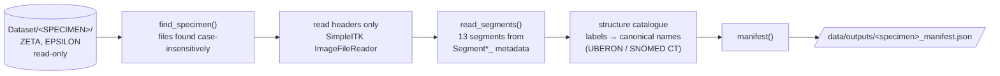

# Stage 1 — Data and exploration

**Goal:** know exactly what the specimen contains before computing anything, without loading
gigabytes into memory.

| | |
|---|---|
| **Input** | OpenEar specimen folders: CBCT DICOM (unembedded, embedded), registered volumes, segmentation, 3D models, histology |
| **Output** | `zeta_manifest.json`: file list, volume geometry (size, 0.125 mm spacing, orientation), 13 segment names, colours and extents |
| **Code** | `backend/src/cochleahub/pipeline/dataset.py`, `cochleahub inspect` |

## Decisions

| | Decision | Basis |
|---|---|---|
| D1 | OpenEar specimen ZETA | public dataset with histology-referenced segmentation [Sieber2019] |
| D2 | use the dataset's segmentation; no model training | the research question is measurement and its presentation, not segmentation [Margeta2022] |
| D3 | header-only inspection; process one segment at a time, cropped to its extent | the segmentation is 2.3 GB in memory |
| D26 | one folder per specimen; free-text labels mapped onto a catalogue of 13 coded structures, unknown labels flagged, never guessed | standard nomenclature mapping [Mayo2018]; coded segment terminology [Fedorov2016] |

## What we found

- The CBCT files lack the DICOM preamble and file meta header (fixed in stage 4, D15). The X/Y/Z
  folders are the same scan resliced.
- The segmentation is a 13-component vector image in RAS coordinates, while the registered
  volumes use LPS.
- The "Scala Vestibuli" label appears to include the vestibule and semicircular canals, which
  shapes stage 2 (D5).
