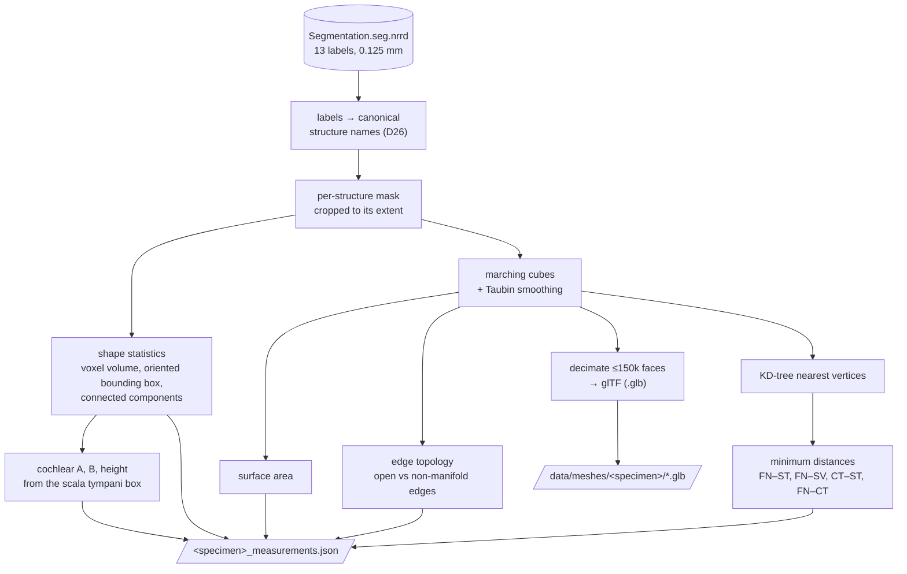

# Stage 2 — Processing and measurement

**Goal:** turn the segmentation into the numbers a cochlear-implant researcher looks at, and into
3D models a browser can show.

| | |
|---|---|
| **Input** | the segmentation (stage 1) |
| **Output** | `<specimen>_measurements.json` (run metadata with the label mapping, 13 structures with their source labels, cochlear dimensions, 4 distances with their closest points) and 13 `.glb` meshes per specimen |
| **Code** | `pipeline/segmentation.py`, `measure.py`, `mesh.py`, `distance.py`, `run.py`; `cochleahub measure` |

## Decisions

| | Decision | Basis |
|---|---|---|
| D4 | SimpleITK for image processing | open, reproducible imaging toolkit [Yaniv2018] |
| D5 | volume, area, oriented-box dimensions, cochlear A/B/height | cochlear size predicts duct length and scala tympani volume [Dhanasingh2021, Schurzig2018, Breitsprecher2022]; A/B/H ranges [Zahara2019] |
| D5 | A/B/H from the scala tympani box (landmark-free proxy) | the dataset's scala vestibuli label includes the vestibule, so the cochlea cannot be isolated from it; no paper uses this exact proxy |
| D6 | minimum distances facial nerve / chorda tympani / cochlea | facial-nerve proximity drives surgical risk [Noble2008] |
| D13 | marching cubes + Taubin smoothing, glTF for the web | [Lorensen1987, Taubin1995]; smoothing cut the area error on test spheres from ~8 % to <1 % |
| D26 | structures are measured under canonical names; a mesh with edges shared by four faces but no open edge counts as closed | coded structure nomenclature [Mayo2018]; scikit-image's marching cubes is Lewiner et al.'s variant [Lewiner2003] |

## Results

| Measure | ZETA | EPSILON |
|---|---|---|
| Scala tympani volume (published 23–50 mm³ [Dhanasingh2021]) | 34.65 mm³ | 33.78 mm³ |
| Cochlear A / B / height (height range 2.80–3.72 mm [Zahara2019]) | 8.97 / 6.81 / 4.36 mm | 8.97 / 7.26 / 4.46 mm |
| Facial nerve → scala tympani | 1.18 mm | 0.14 mm |
| Facial nerve → scala vestibuli | 0.89 mm | 0.50 mm |
| Chorda tympani → scala tympani | 3.65 mm | 6.17 mm |
| Facial nerve → chorda tympani (branch point, 0 mm expected) | 0.00 mm | 0.01 mm |

Both cochlear heights lie above the published range, which comes from another population and
imaging method (D14). EPSILON's facial nerve segment is larger and lies closer to the cochlea.
Its Slicer id suggests it was made from a copy of the nerve segment (D26); the segmentation is
used as given (D2). A run takes about 20 s per specimen.
