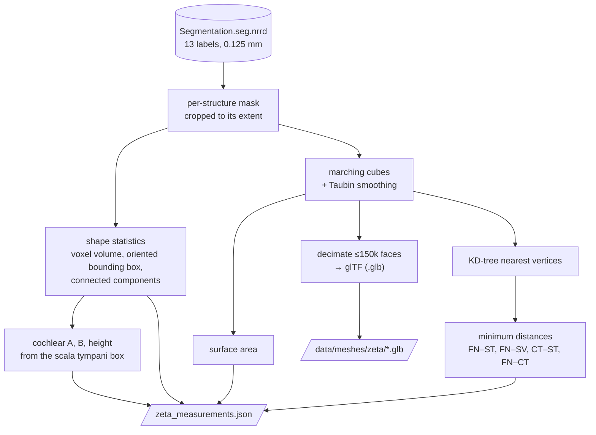

# Stage 2 — Processing and measurement

**Goal:** turn the segmentation into the numbers a cochlear-implant researcher looks at, and into
3D models a browser can show.

| | |
|---|---|
| **Input** | the segmentation (stage 1) |
| **Output** | `zeta_measurements.json` (run metadata, 13 structures, cochlear dimensions, 4 distances with their closest points) and 13 `.glb` meshes |
| **Code** | `pipeline/segmentation.py`, `measure.py`, `mesh.py`, `distance.py`, `run.py`; `cochleahub measure` |

## Decisions

| | Decision | Basis |
|---|---|---|
| D4 | SimpleITK for image processing | open, reproducible imaging toolkit [Yaniv2018] |
| D5 | volume, area, oriented-box dimensions, cochlear A/B/height | cochlear size predicts duct length and scala tympani volume [Dhanasingh2021, Schurzig2018, Breitsprecher2022]; A/B/H ranges [Zahara2019] |
| D5 | A/B/H from the scala tympani box (landmark-free proxy) | the dataset's scala vestibuli label includes the vestibule, so the cochlea cannot be isolated from it; no paper uses this exact proxy |
| D6 | minimum distances facial nerve / chorda tympani / cochlea | facial-nerve proximity drives surgical risk [Noble2008] |
| D13 | marching cubes + Taubin smoothing, glTF for the web | [Lorensen1987, Taubin1995]; smoothing cut the area error on test spheres from ~8 % to <1 % |

## Results (ZETA)

| Measure | Value |
|---|---|
| Scala tympani volume | 34.65 mm³ (published 23–50 mm³ [Dhanasingh2021]) |
| Cochlear A / B / height | 8.97 / 6.81 / 4.36 mm (height above the published 2.80–3.72 mm [Zahara2019]) |
| Facial nerve → scala tympani | 1.18 mm |
| Facial nerve → scala vestibuli | 0.89 mm |
| Chorda tympani → scala tympani | 3.65 mm |
| Facial nerve → chorda tympani | 0 mm: the branch point, as expected anatomically |

The whole run takes about 18 s.
