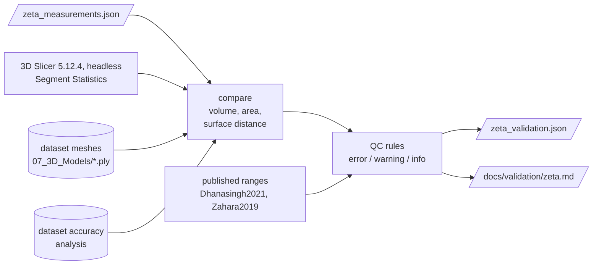

# Stage 3 — Validation and quality control

**Goal:** show that the numbers are computed correctly, and flag anything a user should treat
with care.

| | |
|---|---|
| **Input** | stage 2 outputs, 3D Slicer (optional; the reference result is committed), the dataset's own meshes |
| **Output** | validation JSON, a human-readable report, QC status `pass` / `pass_with_warnings` / `fail` |
| **Code** | `pipeline/validate.py`, `qc.py`, `report.py`, `backend/scripts/slicer_segment_statistics.py`; `cochleahub validate` |

## Decisions

| | Decision | Basis |
|---|---|---|
| D7 | two independent references: 3D Slicer, and the meshes published with the dataset | Slicer as the reference platform [Fedorov2012]; dataset meshes [Sieber2019] |
| D14 | automatic QC flags with severities, including out-of-published-range checks | per-stage quality reporting as in Nautilus [Margeta2022]; ranges [Dhanasingh2021, Zahara2019] |

## Results (ZETA)

- **Volumes:** identical to 3D Slicer for all 13 structures (the same voxels are counted).
- **Surface areas:** +3 to +15 % against Slicer. The largest differences are on thin structures
  (stapes, chorda tympani), whose area depends on how the surface is smoothed.
- **Meshes vs. the dataset's meshes:** mean surface distance 0.05–0.10 mm, below one 0.125 mm
  voxel.
- **QC:** `pass_with_warnings`, with 0 errors, 5 warnings and 10 info flags. The warnings are
  the stapes and chorda tympani area and mesh-volume differences, and cochlear height outside the
  published range.

Full table: [docs/validation/zeta.md](../validation/zeta.md).
