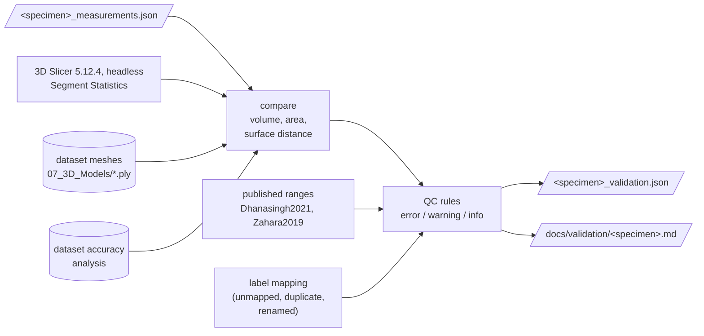

# Stage 3 — Validation and quality control

**Goal:** show that the numbers are computed correctly, and flag anything a user should treat
with care.

| | |
|---|---|
| **Input** | stage 2 outputs, 3D Slicer (optional; the reference result is committed), the dataset's own meshes |
| **Output** | validation JSON, a human-readable report, QC status `pass` / `pass_with_warnings` / `fail` |
| **Code** | `pipeline/validate.py`, `qc.py`, `report.py`, `backend/scripts/slicer_segment_statistics.py`; `cochleahub validate` |

## Decisions

| | Decision | Basis |
|---|---|---|
| D7 | two independent references: 3D Slicer, and the meshes published with the dataset | Slicer as the reference platform [Fedorov2012]; dataset meshes [Sieber2019] |
| D14 | automatic QC flags with severities, including out-of-published-range checks | per-stage quality reporting as in Nautilus [Margeta2022]; ranges [Dhanasingh2021, Zahara2019] |
| D26 | QC flags for label mapping (`UNMAPPED_STRUCTURE`, `DUPLICATE_STRUCTURE`, `STRUCTURE_RENAMED`); a mesh is an error only when it has open edges | standard nomenclature [Mayo2018]; [Lewiner2003] |

## Results

| | ZETA | EPSILON |
|---|---|---|
| Volumes vs. 3D Slicer | identical, 13/13 | identical, 13/13 |
| Surface areas vs. Slicer | +3 to +15 % | +3 to +21 % |
| Mean distance to the dataset's meshes (full resolution) | 0.05–0.10 mm | 0.03–0.09 mm |
| Dataset's own CBCT-vs-histology accuracy | Hausdorff mean 0.034 mm, volume error 0.37 % | Hausdorff mean 0.056 mm, volume error 0.30 % |
| QC | pass with warnings: 0 errors, 5 warnings, 11 info | pass with warnings: 0 errors, 5 warnings, 17 info |

- The volumes match because both tools count the same voxels. Areas differ most on thin
  structures (stapes, chorda tympani; in EPSILON also the cochleovestibular nerve), whose area
  depends on smoothing.
- The warnings are those area and mesh-volume differences, and cochlear height outside the
  published range.
- EPSILON's extra info flags record its four renamed labels and edges shared by four faces in
  two closed meshes (D26).

Full tables: [ZETA](../validation/zeta.md), [EPSILON](../validation/epsilon.md).
