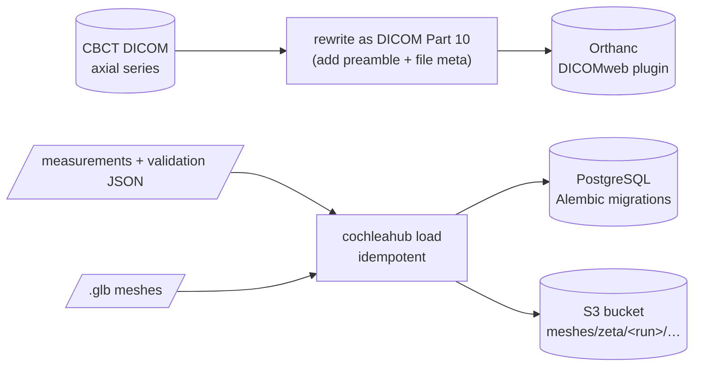
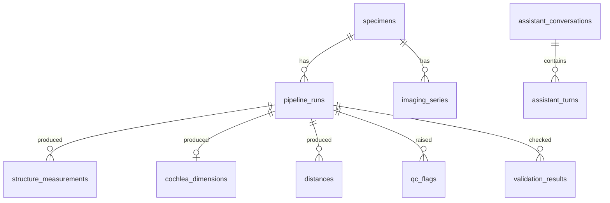

# Stage 4 — Storage (local, AWS-compatible)

**Goal:** put each kind of data where a production system would keep it, with the same
interfaces locally and on AWS.

**Schema (run-centred, D16):** every result belongs to a pipeline run that records its version.

| Local (Docker) | AWS | Content |
|---|---|---|
| PostgreSQL 17 | RDS for PostgreSQL | specimens, runs, measurements, QC, validation, assistant log |
| SeaweedFS (S3 API) | Amazon S3 | meshes; same boto3 code, only the endpoint differs |
| Orthanc + DICOMweb | Orthanc on EC2 / AWS HealthImaging | CBCT, 481 + 401 slices |

## Decisions

| | Decision | Basis |
|---|---|---|
| D8 | Orthanc (DICOMweb) + S3 + PostgreSQL; axial series only | [Jodogne2018, Fedorov2023, Margeta2022]; X/Y/Z are the same scan |
| D15 | rewrite CBCT as DICOM Part 10 before archiving | [DICOM-PS3.10]; pixel data byte-identical, only retired group lengths dropped [DICOM-PS3.5] |
| D16 | run-centred schema, idempotent loader, migrations | traceability per pipeline version [Margeta2022] |

The local S3 is SeaweedFS because MinIO images could not be pulled (October 2026). This is an
engineering choice; no paper is involved.

## Checks

- **CT:** all 882 rewritten files have pixel data byte-identical to the originals. QIDO-RS finds
  both studies, and WADO-RS returns metadata and rendered frames.
- **Meshes:** downloadable through presigned URLs.
- **Loader:** loading the same run twice changes nothing.
