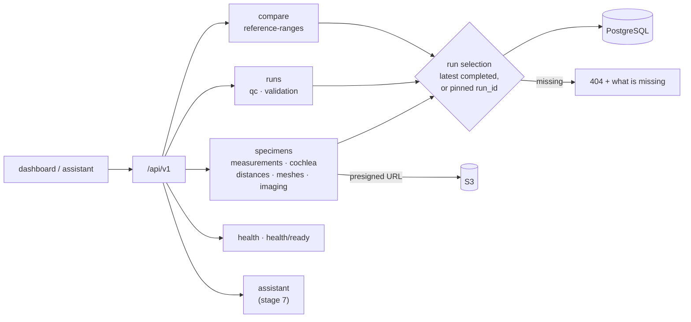

# Stage 5 — Backend API

**Goal:** one read path for the dashboard and the assistant, where every number says where it
came from and missing data are named rather than hidden.



Every run-derived response carries:

```json
"provenance": {"run_id": "19ac527c-…", "specimen_id": "zeta",
               "pipeline_version": "0.1.0", "started_at": "…", "qc_status": "pass_with_warnings"}
```

| | |
|---|---|
| **Code** | `backend/src/cochleahub/api/` (routers, Pydantic schemas, run selection) |
| **Contract** | OpenAPI at `/docs`, exported to `docs/api/openapi.json`; the frontend's TypeScript types are generated from it |

## Decisions

| | Decision | Basis |
|---|---|---|
| D9 | read-only API; results tagged with the pipeline version | traceability [Margeta2022] |
| D17 | latest *completed* run by default, so a failed newer run never hides good results | engineering |
| D17 | 404 names what is missing (unknown specimen, no completed run, …) | lets the assistant abstain instead of guessing [Lee2022] |
| D17 | meshes through short-lived presigned URLs; DICOMweb through a same-origin proxy | private storage; Orthanc never exposed [Jodogne2018] |

## Checks

- 10 API tests. One asserts that the only non-GET route is the assistant's chat.
- Live: readiness reports all three dependencies ok; all 13 presigned mesh URLs download.
