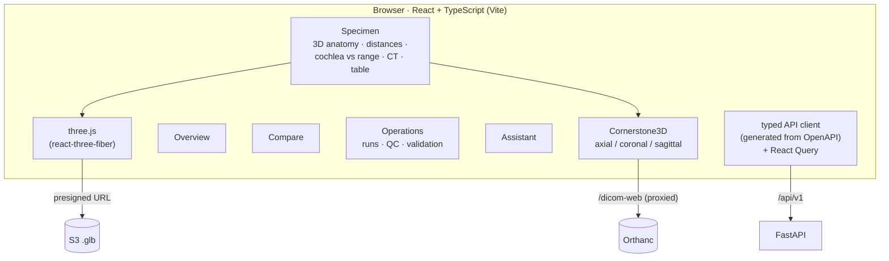

# Stage 6 — Dashboard and viewers

**Goal:** a dashboard that shows the anatomy, the CT and the numbers together, with their
provenance and their uncertainty.

| | |
|---|---|
| **Code** | `frontend/src/pages/*`, `components/MeshViewer.tsx`, `CtViewer.tsx`, `charts.tsx` |
| **Run** | `npm run dev`. The dev server proxies `/api` to FastAPI and `/dicom-web` to Orthanc, so the browser only talks to one origin. |

## Decisions

| | Decision | Basis |
|---|---|---|
| D10 | React/TS SPA; web 3D; DICOMweb slice viewer | React + web viewports in Nautilus [Margeta2022]; OHIF/Cornerstone [Ziegler2020]; dashboards in care [Dowding2015] |
| D18 | Cornerstone3D embedded, not the full OHIF app | CT next to the measurements on one page; engineering |
| D18 | selecting a distance draws the measured segment in 3D | the user sees exactly what was measured (D6) |
| D18 | charts next to a table with the same numbers; palette checked for colour-vision deficiency; QC shown with icon + label | accessibility; no single paper |

## Checks

- All pages render live data in headless Chrome.
- The CT viewer streams the 481-slice series through the proxy.
- Bundles are split, so three.js loads only on the specimen page and Cornerstone only when CT is
  opened.
