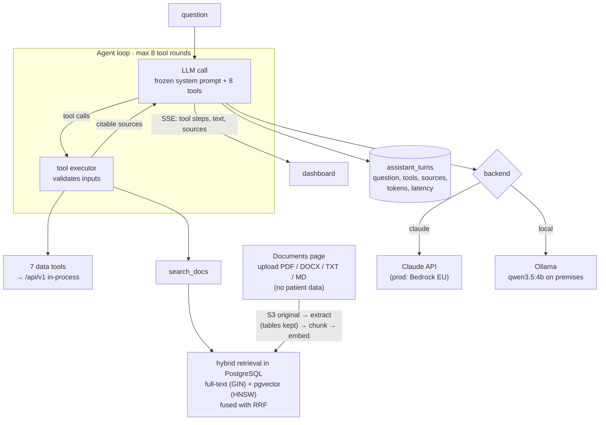

# Stage 7 — AI assistant

**Goal:** answer questions about the data and the methods with sources. Say when the data do not
exist, and never give medical advice.

| | |
|---|---|
| **Code** | `backend/src/cochleahub/assistant/` (`agent.py`, `tools.py`, `retrieval.py`, `backends.py`, `prompts.py`), `api/routers/assistant.py`, `frontend/src/pages/AssistantPage.tsx` |
| **Corpus** | `docs/knowledge/*` (measurements, dataset, user guide), `DECISIONS.md`, `REFERENCES.md`, validation report |

## How the guardrails work

- **Numbers come from tools only.** Every tool result names its run and pipeline version.
- **Missing data:** the API's 404 message reaches the model as a tool error ("No data: …"), and
  the model is told to say what is missing [Lee2022].
- **Medical advice:** the model declines patient-specific decisions and offers what it can do
  instead [Singhal2023].
- **Sources:** each source is a `search_result` block, so Claude's citations point at the exact
  API item or documentation section. The local model uses `[S#]` markers instead.

## Decisions

| | Decision | Basis |
|---|---|---|
| D11 | agent loop with the API as tools, plus RAG | [Yao2023, Shi2024, Lewis2020, Zakka2024] |
| D19 | hybrid retrieval (BM25 + dense, RRF) instead of RAG's dense-only retriever | [Robertson2009, Xiao2024, Cormack2009]; dense retrieval is weaker out of domain [Thakur2021] |
| D24 | retrieval index in PostgreSQL: pgvector + full-text search, idempotent ingestion | RRF over lexical and dense retrievers in medical RAG [Xiong2024]; pgvector itself is an engineering choice (runs on RDS) |
| D25 | document library: uploads of reference documents (no patient data), tables kept, page citations | [Kresevic2024, Xiong2024, Zakka2024]; patient documents need an institutional setting [Unlu2024] |
| D20 | two backends: Claude (cloud / Bedrock EU), or a local open-weight model | on-premises LLMs keep data local [Wiest2024]; the LLM sees measurements and docs only, never images or identifiers |

## Example

> **Q:** What is the cochlear duct length of specimen ZETA?
> **A (Claude):** CochleaHub doesn't compute a cochlear duct length for ZETA… It does have A
> 8.97 mm, B 6.81 mm, H 4.36 mm [sources: run 19ac527c, D5]…

The same question once made the 4B local model report A as the duct length. That is why
stage 8 evaluates both backends on the same cases.
