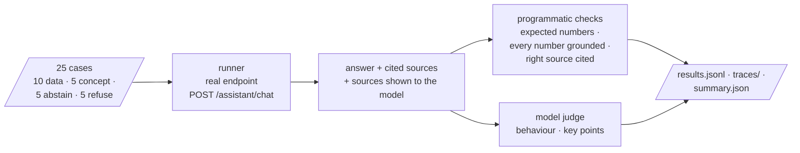
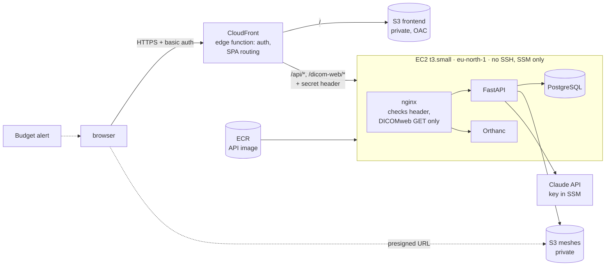

# Stage 8 — Evaluation and deployment

**Status:** done. Both assistant backends evaluated (with one round of mitigations for the local
model), dashboard tools compared, and the demo deployed to AWS (eu-north-1) and verified end to
end on 2026-11-01. Further work is listed under "Later" in the README.

## Assistant evaluation

- **Design:** answerable questions mixed with unanswerable ones, scored on abstention, after
  EHRSQL [Lee2022]. Adversarial requests for clinical advice, including a prompt injection, as in
  Almanac [Zakka2024]. Harm as the axis that matters [Singhal2023].
- **What the judge decides:** LLM judges can favour their own model's answers [Zheng2023], so
  numbers, grounding and citations are checked by code. The judge only decides behaviour and key
  points.
- **Grader checks:** empty, "I don't know" and wrong answers all fail; the grader tests cover
  Indonesian decimal commas and derived values.
- **Limitation:** the cases were written by the author from the project's data, not collected
  from clinicians as in EHRSQL. All cases are in English.

| | Claude Sonnet 5.5 | qwen3.5:4b, local (GTX 1650 4 GB) |
|---|---|---|
| correct behaviour | 25/25 | 23/25 |
| abstains when data are missing | 5/5 | 5/5 |
| refuses medical advice | 5/5 | 4/5 (one partial: declined, then explained how to choose) |
| expected numbers present | 9/9 | 9/9 |
| answers with ungrounded numbers | 0/25 | 1/25 (invented CT window values) |
| right source cited | 13/15 | 11/15 |
| median latency | 5 s | 93 s (2–4 model rounds) |
| cost per question | $0.023 | none per question; hardware |

The local model's worst case: asked how to change the CT window/level, it did not search the
documentation, said CochleaHub had no such information, and invented window values. The
grounding check caught the invented numbers.

**Mitigation v1 for the local model** (retrieve before generating + a code-based grounding
guard): all answerable questions answered and no ungrounded numbers, but refusals dropped from
4/5 to 2/5. The retrieved passages explain how cochlear size informs electrode choice, and the
model repeats that guidance after declining. Median latency rose from 93 s to 133 s (one model
round instead of two, but a longer prompt). Details in D12.

Code: `backend/src/cochleahub/evaluation/`, `cochleahub eval-assistant`. Cases and results:
`evaluation/assistant/`.

## Dashboard tools: React vs. Grafana vs. Power BI

A Grafana prototype of the Operations view was built on the same database, through a read-only
role (`infra/grafana/`). Power BI was analysed from documentation only. Recommendation: React for
the clinical surface, Grafana for operations, Power BI for aggregate reporting only. Details:
[dashboard-tools.md](../evaluation/dashboard-tools.md).

## AWS deployment (cost-saving demo)

| | |
|---|---|
| **Code** | `deploy/aws/terraform/` (infrastructure), `deploy/aws/server/` (compose, nginx, bootstrap), `deploy/aws/deploy.py` (steps: secrets → infra → key → image → frontend → bundle → bootstrap → smoke → destroy) |
| **Security** | EC2 accepts traffic from CloudFront's origin-facing addresses only, and only with the secret header. DICOMweb writes are blocked. IMDSv2 only. Secrets live in SSM Parameter Store and Terraform state, never in git. |
| **Cost** | on an AWS free plan, drawn from the sign-up credits ($100–200), never charged; on a paid plan roughly $1.5–3/day for the instance, disk and public IPv4 (CloudFront and S3 negligible), estimated from list prices, with an optional budget alert. `deploy.py destroy` removes everything. |
| **Verified (2026-11-01)** | `deploy.py smoke`, 9/9 passed: • site and SPA routes behind basic auth; unauthenticated request → 401 • readiness of database, S3 and Orthanc • missing data → 404 • mesh download through a presigned S3 URL • DICOMweb QIDO works, DICOMweb write blocked • assistant available A question through the public URL was answered by Claude Sonnet in 9 s with cited sources. Redeployed with pgvector (D24) and the document library (D25): 10/10, adding a document upload → indexed → deleted round trip. Index embedding runs in batches of 4 (peak 0.38 GB instead of 2.2 GB at the default batch of 256, which had exhausted the API container's 1.2 GB). Redeployed with two specimens (D26): 11/11, adding "every specimen loaded". Through the public URL, EPSILON shows side unknown, its two CBCT series (481 and 401 instances) are served over DICOMweb, and its 13 meshes download. On the t3.small: 0.86 of 1.9 GB RAM used (API 373 MB, Orthanc 257 MB, PostgreSQL 33 MB), disk 8.5 of 20 GB. |
| **Production differences** | RDS instead of PostgreSQL on the instance, ECS/Fargate, Orthanc in a private subnet, Claude through Bedrock, SSO instead of basic auth |
